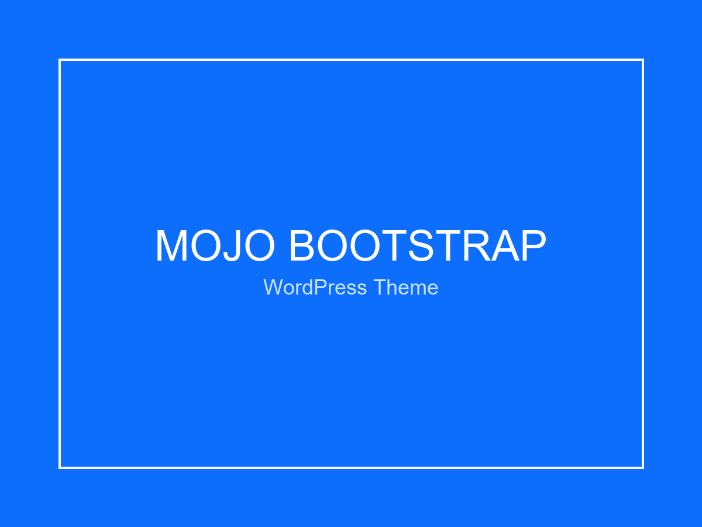

# Mojo Bootstrap - WordPress Theme

**Mojo Bootstrap** adalah tema WordPress modern, ringan, dan responsif yang dibangun menggunakan **Bootstrap 5.3**. Tema ini dirancang mengikuti standar resmi WordPress Theme Handbook dan siap digunakan untuk blog, majalah, portofolio, maupun situs perusahaan.



---

## 🚀 Fitur Utama

- **Bootstrap 5.3 & Bootstrap Icons**: Menggunakan versi terbaru Bootstrap via CDN berkecepatan tinggi.
- **Bootstrap 5 NavWalker**: Dukungan menu navigasi bertingkat (dropdown menu) bawaan WordPress yang kompatibel penuh dengan Bootstrap.
- **Desain Responsif & Mobile-First**: Tampilan optimal di smartphone, tablet, laptop, dan desktop.
- **Dukungan Gutenberg & HTML5**: Kompatibel dengan block editor WordPress (`alignwide`, `alignfull`, semantic HTML5 tags).
- **Template Lengkap**:
  - `front-page.php` - Halaman beranda dengan hero section interaktif.
  - `index.php` - Daftar artikel grid responsif.
  - `single.php` - Halaman detail artikel lengkap dengan metadata, author box, dan navigasi pos.
  - `page.php` - Halaman statis bersih dan rapi.
  - `archive.php` - Halaman arsip kategori, tag, dan tanggal.
  - `search.php` & `searchform.php` - Halaman dan form pencarian.
  - `404.php` - Halaman error not found yang informatif.
  - `comments.php` - Formulir komentar berdesain modern Bootstrap.
- **Area Widget & Menu**:
  - 1 Main Sidebar Widget Area
  - 2 Footer Column Widget Areas
  - 2 Lokasi Menu: Primary Menu (Navbar Header) & Footer Menu

---

## 📋 Persyaratan Sistem

- **WordPress**: 6.0 atau versi lebih baru
- **PHP**: 7.4 atau versi lebih baru

---

## 📦 Cara Instalasi

### Opsi 1: Upload File ZIP via WordPress Admin (Direkomendasikan)
1. Download repository ini sebagai file ZIP (atau zip folder `mojo-bootstrap`).
2. Masuk ke Dashboard WordPress Anda (`wp-admin`).
3. Buka menu **Appearance (Tampilan) > Themes (Tema)**.
4. Klik tombol **Add New (Tambah Baru)** lalu klik **Upload Theme (Unggah Tema)**.
5. Pilih file `mojo-bootstrap.zip` dan klik **Install Now (Pasang Sekarang)**.
6. Klik **Activate (Aktifkan)** setelah proses instalasi selesai.

### Opsi 2: Menggunakan Git Clone
Buka terminal dan navigasikan ke direktori instalasi WordPress Anda:
```bash
cd /path/ke/wordpress/wp-content/themes/
git clone https://github.com/USERNAME/mojo-bootstrap.git mojo-bootstrap
```
Lalu aktifkan tema melalui **Appearance > Themes** di Dashboard WordPress.

---

## ⚙️ Panduan Pengaturan Tema

### 1. Menu Navigasi Default
Tema ini secara otomatis telah menyiapkan menu navigasi default:
- **Beranda** (Home)
- **Tentang Kami** (About Us)
- **Berita** (Blog / Articles)
- **Kebijakan Privasi** (Privacy Policy)

Saat tema diaktifkan pertama kali, tema secara otomatis membuat halaman-halaman tersebut dan mendaftarkan **Menu Utama** ke lokasi *Primary Menu* dan *Footer Menu*. Anda juga dapat mengkustomisasi menu kapan saja melalui **Appearance > Menus**.

### 2. Menyiapkan Widget Sidebar & Footer
1. Buka **Appearance > Widgets**.
2. Tambahkan widget ke:
   - **Main Sidebar**: Muncul di samping konten artikel & arsip.
   - **Footer Column 1 & 2**: Muncul di bagian bawah situs.

### 3. Menyiapkan Halaman Beranda (Homepage)
1. Buka **Settings > Reading**.
2. Pilih apakah Anda ingin menampilkan artikel terbaru (*Your latest posts*) atau halaman statis (*A static page*).

---

## 📁 Struktur Direktori

```text
mojo-bootstrap/
├── assets/
│   ├── css/
│   │   └── main.css           # Kustom styling tambahan tema
│   ├── js/
│   │   └── main.js            # Inisialisasi skrip Bootstrap & interaksi UI
│   └── images/                # Aset gambar tema
├── inc/
│   └── class-bootstrap-navwalker.php  # Bootstrap 5 Nav Walker untuk WordPress
├── template-parts/
│   ├── content.php            # Tampilan kartu pos di arsip/blog
│   ├── content-single.php     # Konten artikel tunggal
│   ├── content-page.php       # Konten halaman statis
│   └── content-none.php       # Pesan jika konten tidak ditemukan
├── 404.php                    # Template halaman tidak ditemukan
├── archive.php                # Template arsip
├── comments.php               # Template komentar
├── footer.php                 # Footer situs
├── front-page.php             # Halaman beranda
├── functions.php              # Pendaftaran fitur, enqueue skrip, dan widget
├── header.php                 # Header dan navbar situs
├── index.php                  # Template blog utama
├── page.php                   # Template halaman tunggal
├── screenshot.png             # Thumbnail pratinjau tema di wp-admin
├── search.php                 # Halaman hasil pencarian
├── searchform.php             # Formulir pencarian
├── single.php                 # Template artikel tunggal
├── style.css                  # Metadata tema & style dasar
└── README.md                  # Dokumentasi
```

---

## 📄 Lisensi

Tema ini dirilis di bawah lisensi [GNU General Public License v2.0 or later](http://www.gnu.org/licenses/gpl-2.0.html).
